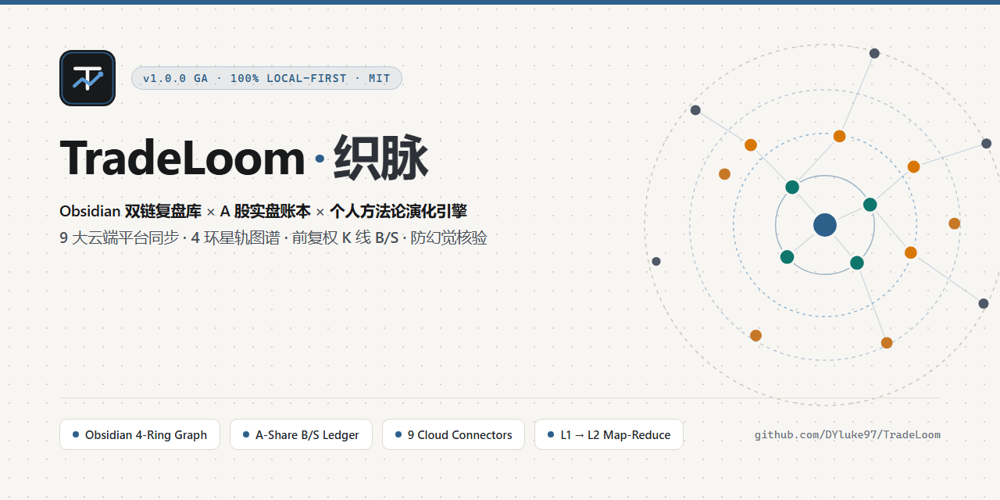
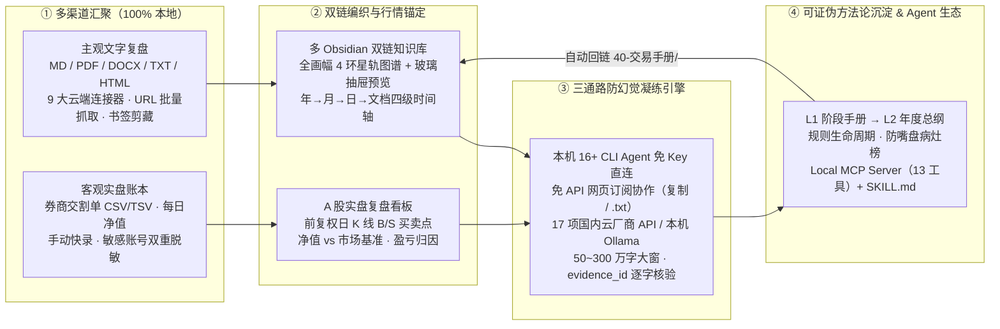

<div align="center">


# TradeLoom · 织脉

**Local-First 投研复盘双链知识库 × A 股实盘投资账本 × Agent 原生交易方法论演化引擎**

将散落在本地文档与 **9 大主流云端笔记平台** 的盘后复盘，自动编织为 **全画幅 4 环同心双链星图**；  
挂载真实 **A 股交割单、每日净值与前复权 K 线 `B/S` 买卖点**；  
支持 **16+ 款本机 CLI Agent 免 Key 直连**、**免 API 网页订阅协作**、**国内主流云厂商 API** 及 **Local MCP Server 双向接入**；  
通过 **50~300 万字大上下文装箱**、**逐字证据防幻觉核验** 与 **定性 × 定量交叉证伪**，沉淀可回溯、可证伪、防“嘴盘”的个人交易手册体系。

[](./package.json)
[](./LICENSE)
[](./package.json)
[](#4-零-api-门槛三通路-ai-引擎与-local-mcp-双向接入)
[](#4-零-api-门槛三通路-ai-引擎与-local-mcp-双向接入)
[](#2-全渠道复盘汇聚与两级云端同步中心)
[](#七安全与隐私红线)

[v1.2.1 更新亮点](#-v121-核心更新亮点) · [为什么做 TradeLoom](#一为什么做-tradeloom) · [核心功能体系](#二核心功能体系) · [工作台路由](#三多库并行与八大工作台) · [快速开始](#四快速开始按人群任选-4-种方式) · [安全与隐私](#七安全与隐私红线)

<br />



</div>

---

## 🆕 `v1.2.1` 核心更新亮点

- **曜石投研终端质感 × 方正极细精密排版**：默认启用曜石暗色投研终端（右上角一键切换温润纸本亮色），确立 **复盘钴蓝 / 概念青绿 / 实盘琥珀 / 手册翡翠 / 风控珊瑚红** 独立语义色板；全站收紧为 `2px–4px` 方正锐利倒角，搭配轻量化细笔画字体层级与等宽量化数字对齐。
- **100% 全画幅沉浸星图 × 右侧玻璃预览抽屉**：进入 `/vault?view=graph` 自动收折左右固定栏与多余小星图，释放全视口四环星轨画布；新增悬浮玻璃 HUD、节点即时搜索定位、曲线引力连线与绽放入场动效；**单击节点滑出 380px 玻璃预览抽屉**（同屏挂载当日实盘锚点与相连节点漫游胶囊，不离开星图），双击或点按钮再进入完整文档阅读。
- **16+ 款本机 CLI Agent 免 API Key 直连**：后台自动扫描并免 Key 直连 **Claude Code、OpenAI Codex CLI、Gemini CLI、Antigravity CLI（`agy` 原生 `stream-json` 无上限标准输入）、ZCode CLI（`--mode plan` 只读沙盒）、Cursor Agent、OpenCode、Kimi CLI、Qwen Code、腾讯 CodeBuddy、iFlow、OpenClaw、GitHub Copilot、Goose、AWS Kiro、Aider** 及**自定义本机 CLI**，直接复用现有订阅额度完成凝练。
- **免 API 网页 / 订阅协作闭环 + 国内主流云厂商全覆盖**：
  - 零 API 用户可在 `/synthesize` 一键复制完整证据提示词包或下载 `.txt` 附件发给 ChatGPT / Claude / DeepSeek / Kimi / 豆包网页版，贴回回复自动完成 `evidence_id` 逐字防幻觉核验落盘；
  - API 通道内置 **17 项分组预设**，新增 **ZCode（智谱 GLM Coding 套餐国内/国际站）、火山引擎方舟 Ark、阿里云百炼、腾讯云混元 & LKEAP、华为云 ModelArts MaaS、百度千帆、月之暗面 Kimi、Google AI Studio、OpenRouter** 及本机免 Key 的 **Ollama / LM Studio**。
- **外部 Agent 双向接入（Local MCP Server + 标准 `SKILL.md`）**：原生提供 Streamable HTTP（`http://127.0.0.1:3200/api/mcp`）与零依赖 Stdio 桥接脚本（`scripts/tradeloom-mcp-server.mjs`），开放 **13 个 MCP 工具**（支持本机文件/文件夹无损直传、多复盘库防误写选库确认、自然语言新建库、网页抓取与交割单脱敏入库），设置页提供一键复制本机配置与连通自检。
- **单次提炼容量 6.25× 大幅扩容**：单次装箱上限从 8 万字提升至 **默认 50 万字（四档可选：20 万 / 50 万 / 120 万 / 300 万字全量）**，单次勾选上限扩至 **1,500 篇**，充分释放 200K–1M+ 长上下文大模型能力。
- **零概念负担冷启动与渐进解锁导航**：全新品牌织脉开场动画 → 极简命名激活主库 → 大画幅多渠道累计入库 + 全局唯一「开始织脉」按钮 → 两级云端同步中心（9 平台矩阵 → 单平台专页）→ 渐进式解锁顶栏（随时可点「跳过引导，展开全部菜单」自由探索）。

---

## 一、为什么做 TradeLoom？

大多数交易者写了几百篇盘后复盘，最终却沦为“只写不看”的流水账；而直接把历史笔记丢给通用大模型总结，往往踩中四大硬伤：

| 传统复盘痛点 | TradeLoom `v1.2.1` 的工程解法 |
| :--- | :--- |
| **文字与盈亏割裂**：复盘写得头头是道，却分不清是牛市 Beta 顺风还是真实 Alpha，也看不清个股是否反复高买低卖 | **实盘账本 × A 股真实行情**：导入券商交割单与日度净值，在前复权日 K 线上精准锚定每一笔 `B/S` 买卖点，叠加沪深300 / 科创50 / 中证1000 等基准曲线自动核算超额收益与最大回撤 |
| **大模型幻觉与套话**：凭空捏造没做过的标的、胜率与收益，输出毫无实战价值的教科书式空话 | **服务端逐字证据核验（Zero-Hallucination）**：服务端预先将复盘原文切分为带 `evidence_id` 的证据片段；模型仅允许引用合法 ID，落盘前由服务端逐字回填真实原文并剔除一切无据幻觉 |
| **没有 API Key / 不想额外充钱**：手里已有 Claude / ChatGPT / Gemini / ZCode / DeepSeek / Kimi 订阅或本地 Agent，卡在 API 门槛 | **三通路零门槛凝练 + Local MCP Server**：既可免 Key 直连本机 16+ 款 CLI Agent 或复制证据包用网页订阅协作，也可通过标准 MCP 让外部 Agent 直接读写复盘并提交校验手册 |
| **多年长周期超限 & “嘴盘”失真**：3~5 年复盘动辄数十万字，日记立 Flag 却实盘反复违纪 | **50~300 万字大窗装箱 + L1→L2 Map-Reduce + 防嘴盘审计**：单次最高勾选 **1,500 篇 / 300 万字**，结合实盘绩效自动触发 `[实盘绩效存疑预警]` 与知行偏离病灶榜 |

### 端到端投研复盘闭环架构



---

## 二、核心功能体系

### 1. 多 Obsidian 双链知识库 & 全画幅 4 环同心星轨图谱

- **多知识库并行隔离**：不同交易账户、策略流派或名家历史语料彼此完全独立，支持直接**外挂本地已有 Obsidian Vault 文件夹**，零迁移成本。
- **全画幅沉浸式 4 环星轨图谱（`/vault?view=graph`）**：
  - 严格按投研知识层级解耦为 4 层 360° 同心星轨（`中心总览 MOC → ORBIT 01 主题星核环 → ORBIT 02 年度档案环 → ORBIT 03 月度时间索引环 → ORBIT 04 复盘原件外环`），自动收折左右边栏释放 100% 视口。
  - 悬浮玻璃 HUD 集成**节点即时搜索定位**、星轨/泳道布局切换、骨架/全量切换与曲线引力脉冲连线。
  - **单击节点弹出右侧 380px 玻璃预览抽屉**（含正文预览、当日实盘锚点与相连节点漫游胶囊），双击节点或点按钮切入完整双链阅读与编辑。
- **四级可折叠时间轴导航树**：原生支持 **`年 → 月 → 日 → 复盘文档`** 四层穿透折叠，跨 5 年、130+ 篇复盘全量双链并发重建仅需 **`~275ms`**。
- **纯正 Obsidian 原生结构**：自动维护 `00-总览.md`、`10-时间轴/`、`10-每日/`、`20-卡片/`、`30-主题/`、`40-交易手册/` 与未链接提及（Unlinked Mentions），支持全窗口拖拽上传与一键导出 `.zip`。

### 2. 全渠道复盘汇聚与两级云端同步中心

两级清爽交互（**9 平台卡片矩阵 → 单平台专属同步页**），一次全局授权，同步时可自由指定写入任意目标知识库：

| 平台 | 接入协议 / 认证模式 | 核心同步能力 |
| :--- | :--- | :--- |
| **滴答清单 / TickTick** | 官方远程 MCP · 一键 OAuth 2.0 (PKCE) | 自动发现清单列表、多清单点选、过滤系统欢迎任务、同步盘后复盘笔记 |
| **Notion** | 官方远程 MCP OAuth / Integration Token | 支持一键登录或指定 Database / Page URL 及全文搜索，完整还原块级 Markdown |
| **飞书文档 / Lark** | RFC 8628 扫码一键建应用 + 本机 `lark-cli` 双模 | 免开后台扫码即建自建应用，或直连本机 `lark-cli` 自动检索个人云文档与知识库 |
| **有道云笔记** | 官方远程 MCP (SSE) · 单 API Key | 无需部署额外中间件，支持目录树浏览点选与关键词检索同步 |
| **腾讯文档** | 官方远程 MCP（免费 2,000 次/天） | 覆盖知识库空间与云盘目录，支持空间/文件夹多选过滤 |
| **腾讯 ima** | 官方 OpenAPI 双通道（免费） | 同时打通「个人笔记本」与「ima 知识库」双通道检索拉取 |
| **Microsoft OneNote** | Windows 桌面版原生 COM 零配置直连 | **免注册 Azure、免填密钥、免装 Word/Pandoc**，本机直接解析分区与表格为干净 Markdown |
| **语雀** | 官方 Open API v2 | 自动拉取个人/团队空间知识库与语雀小记，支持知识库多选与关键词过滤 |
| **印象笔记 · 国内版** | 官方 Skill RESTful API（1 年期令牌） | 支持笔记本与标签筛选及全文检索；免费版提供导出 `.html` 批量拖拽无损导入引导 |

此外还内置 **公开网页 URL 批量抓取队列**（深度适配雪球、新浪财经博客、微信公众号等，单次最多 50 条）以及 **富文本粘贴 & 浏览器书签一键剪藏**（本地加密令牌 `X-TradeLoom-Clip-Token`）。

### 3. A 股实盘投资账本与行情买卖点复盘

- **券商交割单 & 每日净值无痛导入**：兼容 **UTF-8 / GB18030 / UTF-16LE / TSV** 格式，预览与入库双阶段**强制脱敏资金账号、股东代码、委托/流水号、身份证等敏感列**。
- **真实前复权日 K 线 × `B/S` 买卖点叠加**：直连东方财富 / 腾讯财经公开接口获取沪深北 A 股及可转债前复权日线（本地缓存于 `market-cache/`，自动识别除权除息漂移并刷新复权价）。
- **净值 vs 市场基准量化看板**：支持切换 **沪深300 / 上证指数 / 创业板指 / 科创50 / 中证1000**，自动统计累计收益、超额 Alpha、最大回撤（MDD）、日胜率、盈亏比（PF）、最高仓位与融资天数。

### 4. 零 API 门槛：三通路 AI 引擎与 Local MCP 双向接入

1. **通路 ① · 本机 CLI Agent 免 API Key 直连（16+ 款内置 + 自定义命令）**：
   - 自动探测并复用本机已登录订阅的官方命令行 Agent：
     - **主流订阅 CLI**：Claude Code (`claude`)、OpenAI Codex CLI (`codex`)、Gemini CLI (`gemini`)、Antigravity CLI (`agy`)、Cursor Agent (`cursor-agent`)、GitHub Copilot (`copilot`)、AWS Kiro (`kiro-cli`)
     - **国产 / 免费额度 CLI**：**ZCode CLI (`zcode`)**、Kimi CLI (`kimi`)、Qwen Code (`qwen`)、腾讯 CodeBuddy (`codebuddy`)、iFlow 心流 (`iflow`)
     - **开源生态**：OpenCode (`opencode`)、OpenClaw (`openclaw`)、Goose (`goose`)、Aider (`aider`)，以及支持 `stdin` / `{prompt_file}` 的**自定义本机 CLI**
   - 所有调用运行在隔离空临时目录中，长复盘通过 `stdin`（如 `agy` 原生 `stream-json`）或临时文件无损传递，ZCode 显式强制 `--mode plan` 只读边界。
2. **通路 ② · 免 API 网页 / 订阅协作（全平台零门槛兜底）**：
   - 一键生成并复制完整证据提示词包或下载 `.txt` 附件，发给 ChatGPT / Claude / DeepSeek / Kimi / 豆包网页版后贴回回复，照样通过服务端 `evidence_id` 逐字防幻觉核验并落盘手册。
3. **通路 ③ · OpenAI 兼容 API 与本机离线模型（17 项分组预设）**：
   - 涵盖 **ZCode（智谱 GLM Coding 套餐国内/国际站）、智谱 BigModel、DeepSeek、火山引擎方舟（豆包 Ark）、阿里云百炼、腾讯云混元、腾讯云 LKEAP、华为云 ModelArts MaaS、百度智能云千帆、月之暗面 Kimi、硅基流动免费池、OpenAI、Google AI Studio、OpenRouter**，以及本机免 Key 的 **Ollama / LM Studio**。
4. **外部 Agent 反向驱动 TradeLoom（Local MCP Server + 标准 `SKILL.md`）**：
   - 原生开放 Streamable HTTP（`http://127.0.0.1:3200/api/mcp`）与零依赖 Stdio 桥接脚本（[scripts/tradeloom-mcp-server.mjs](./scripts/tradeloom-mcp-server.mjs)，`pnpm mcp`）以及跨平台 [docs/tradeloom-agent-skill/SKILL.md](./docs/tradeloom-agent-skill/SKILL.md)。
   - 暴露 **13 个 MCP 工具**：`tradeloom_list_vaults`、`tradeloom_create_vault`、`tradeloom_search_reviews`、`tradeloom_read_review`、`tradeloom_import_local_files`（直传本机 `.md/.txt/.pdf/.docx/.html` 文件或目录，支持 `dryRun` 预览）、`tradeloom_import_review`、`tradeloom_import_url`、`tradeloom_import_ledger`、`tradeloom_get_ledger_summary`、`tradeloom_list_skills`、`tradeloom_prepare_synthesis`、`tradeloom_save_manual`、`tradeloom_list_manuals`。
   - **多复盘库防误写护栏**：当本机存在 ≥ 2 个个人复盘库且写入未指定 `vaultId` 时，服务端自动拒绝盲写并返回各库名称、简介与高频主题 `topTopics`，倒逼 Agent 结合内容推荐目标库并先向用户确认（支持精确库名匹配或调用 `tradeloom_create_vault` 现建新库）。
   - 设置页「外部 Agent 接入（MCP / Skill）」支持一键复制按本机真实路径生成的 MCP JSON、`claude / codex / agy / gemini mcp add` 一行命令与在线连通检测。

### 5. 定性 × 定量交叉审计、大上下文装箱与 Skill 工坊

- **50~300 万字大上下文装箱 & L1→L2 分层综合**：单次默认支持 **50 万字**（可切换 20 万 / 50 万 / 120 万 / 300 万字，最多 1,500 篇），支持先分阶段产出 L1 手册，再 Map-Reduce 跨周期综合为 L2 年度总纲。
- **全链路 4 处定量交叉核验**：每日卡片挂载同日盈亏与交割点；阶段提炼仅传脱敏百分比与比率（零绝对资金外发）；实盘失真自动触发 `[实盘绩效存疑预警]`；手册自动回写 Obsidian `40-交易手册/`。
- **内置 5 套流派 Skill + 可视化工坊**：涵盖 `综合阶段归纳`、`短线情绪博弈`、`基本面五维分析`、`趋势波段与盈亏比管理`、`资源周期与仓位杠杆风控`，支持一键克隆魔改。

---

## 三、多库并行与八大工作台

| 页面路由 | 作用域 | 核心定位 | 关键能力与产出 |
| :--- | :---: | :--- | :--- |
| **`/` 工作台概览** | 本库 | 三线织脉驾驶舱与冷启动 | 首次进入呈现开场动画 → 建库 → 多渠道累计入库与全局「开始织脉」；日常打开直达「三线织脉画布（复盘 × 实盘 × 规则）」与微图形信号卡 |
| **`/vault` 复盘与星图** | 本库 | 全画幅星图与双链阅读器 | 100% 全画幅 4 环星轨图谱 + 右侧玻璃预览抽屉、节点搜寻、四级时间轴树、拖拽导入、概念词典编辑器与 `.zip` 导出 |
| **`/ledger` 本库账本** | 本库 | 实盘净值与个股 K 线 | 净值 vs 基准曲线、最大回撤水下曲线、个股前复权日 K 线 `B/S` 买卖点复盘、券商 CSV/TSV 脱敏导入 |
| **`/synthesize` 提炼方法论** | 本库 | L1 / L2 凝练工坊 | 20 万~300 万字四档装箱、直连提炼（本机 CLI Agent / API）与免 API 网页协作双模式、SSE 流式进度与取消 |
| **`/manuals` 交易手册馆** | 本库 | 二层方法论档案库 | **L2 年度总纲 → 嵌套 L1 阶段手册**、原文证据折叠溯源、规则生命周期标记、防“嘴盘”知行偏离审计榜 |
| **`/vaults` 全部知识库** | 全局 | 多库并行管理大厅 | 卡片化管理全部并行知识库（新建、外挂本地 Obsidian 目录、默认 Skill 绑定、独立导出、安全回收站） |
| **`/sync` 云端同步** | 全局 | 两级 9 平台连接器中心 | 平台矩阵选平台 → 单平台专属同步页，全局一次授权并可指定写入任意目标知识库 |
| **`/settings` 系统设置** | 全局 | AI 引擎 / MCP / Skill 中枢 | 本机 16+ CLI Agent 扫描直连、17 项国内外 API 预设、外部 Agent 接入（MCP / SKILL.md）、可视化 Skill 工坊与词典编辑 |

---

## 四、快速开始（按人群任选 4 种方式）

### 方式 1：Windows 绿色便携版双击即用（推荐交易员 / 非技术用户，零依赖）

无需安装 Node.js、Git 或任何开发环境（已内置独立 `runtime/node.exe`、原生无黑框 `TradeLoom.exe` 启动器与 Local MCP 脚本）：

1. 在 [Releases 页面](https://github.com/DYluke97/TradeLoom/releases) 下载最新 `TradeLoom-v1.2.1-win-x64.zip`；
2. 完整解压至任意普通文件夹（如桌面或 `D:\TradeLoom`）；
3. 双击 **`TradeLoom.exe`**，2~5 秒后自动拉起本地引擎与独立应用窗口（最小化可常驻系统托盘）；
4. 全部个人数据保存在同级 `workspace/` 文件夹内，升级或迁移只需保留该目录。

> 💡 源码用户可执行 `pnpm run pack:win`（或 `npm run pack:win`）一键编译原生启动器并通过隐私门禁校验，生成 `dist/TradeLoom-v1.2.1-win-x64.zip`。

### 方式 2：交给 AI Agent 启动并接入 MCP（Claude Code / Codex / Antigravity / Cursor / OpenClaw）

便携包根目录内置 Agent 启动脚本，同时源码/便携包均内置零依赖 MCP Server：

```powershell
# 1. 启动本地 TradeLoom 服务（自动寻址空闲端口并输出 JSON）
powershell -ExecutionPolicy Bypass -File .\start-agent.ps1

# 2. 注册 Local MCP Server（以 Claude Code / Codex / Antigravity 为例）
claude mcp add tradeloom -- node "E:\TradeLoom\scripts\tradeloom-mcp-server.mjs"
# 或在支持 Streamable HTTP 的客户端直接指向 http://127.0.0.1:3200/api/mcp
```

### 方式 3：Docker Compose 一键运行（Windows / macOS / Linux 跨平台）

```bash
git clone https://github.com/DYluke97/TradeLoom.git
cd TradeLoom
docker compose up -d
```

浏览器打开 `http://127.0.0.1:3200`，个人知识库与账本数据自动持久化挂载于宿主机 `./workspace`。

### 方式 4：开发者源码运行（需 `Node.js >= 22.13.0`）

```bash
git clone https://github.com/DYluke97/TradeLoom.git
cd TradeLoom
pnpm install
pnpm dev
```

访问 `http://127.0.0.1:3200` 即可开始使用（同样支持 `npm install && npm run dev`）。

---

## 五、5 分钟上手闭环

1. **极简建库与多渠道喂料**：首次打开 `http://127.0.0.1:3200`，为你的知识库命名后，通过本地拖拽、粘贴正文、网页链接批量抓取或 9 大平台云同步累计入库，确认篇数后点击全局 **「开始织脉」**。
2. **全画幅星图漫游**：进入 100% 全画幅 4 环星图，单击发光节点在右侧玻璃抽屉预览关联复盘与相连脉络，也可直接搜索定位任意日期或概念。
3. **可选挂载实盘交割单**：前往 `/ledger` 拖入券商交割单或每日净值 CSV，在真实前复权日 K 线上核验买卖点与回撤。
4. **零门槛凝练交易手册**：在 `/settings` 选择 **本机 CLI Agent 免 Key 直连**（如 `agy / claude / codex / gemini / zcode / opencode`）、**免 API 网页订阅协作** 或 **国内云厂商 API / 本机 Ollama**，进入 `/synthesize` 生成带逐字原文溯源的个人交易手册并自动解锁完整工作台。

---

## 六、仓库目录与本地数据布局

```text
TradeLoom/
├── AGENTS.md                        # 项目顶层 AI Agent 协作规则与工程记忆
├── src/
│   ├── app/                         # Next.js 15 App Router（8 大工作台 + REST/SSE/MCP API）
│   ├── middleware.ts                # 本地回环 Host 校验（防 DNS Rebinding）与 CSRF 拦截中间件
│   ├── components/                  # 曜石终端壳层、三线织脉画布、全画幅星图、实盘 K 线、Agent 集成面板
│   └── lib/                         # 双链引擎、16+ 本机 CLI Agent 调度器、Local MCP Server、9 大云端连接器与防幻觉提炼
├── skills/                          # 5 套内置只读交易流派分析 Skill 模板
├── docs/
│   ├── tradeloom-agent-skill/       # 标准外部 Agent SKILL.md（可直接挂载至各大 Agent）
│   └── v1.2-visual-and-graph-design-plan.md
├── scripts/
│   ├── tradeloom-mcp-server.mjs     # 零依赖 Stdio Local MCP 桥接服务（pnpm mcp）
│   ├── build-portable-win.ps1       # Windows 便携版打包 + 原生启动器编译 + 隐私门禁脚本
│   └── portable-templates/          # 便携版启动器与 Agent 协议模板
├── __tests__/                       # Vitest 自动化测试套件（13 文件 / 76 用例）
└── workspace/                       # 【已严格 .gitignore】100% 本地私有数据（单目录备份即迁移）
```

---

## 七、安全与隐私红线

- **100% Local-First 零遥测**：无官方云端后端、无账号注册、无任何统计埋点。所有复盘原文、实盘交割单与 API Key 只保存在本机磁盘 `workspace/` 中；切换不同大模型服务商域名时自动隔离历史 API Key，防止密钥跨源泄露。
- **账户资金绝对金额零外发**：交割单导入时在预览与存储双层屏蔽资金账号、股东代码、客户姓名等敏感列；向大模型或外部 Agent 发送区间定量摘要时，**仅传递收益率 `%`、回撤 `%`、胜率与盈亏比等脱敏比率，绝不发送任何人民币本金或成交总额**。
- **本机 CLI Agent 沙盒隔离**：所有本机 CLI Agent 调用均在空临时目录运行，超长提示词走 `stdin` 或临时文件传递（彻底规避命令行注入与 Windows 32KB 上限），ZCode 等默认高权限 CLI 强制 `--mode plan` 只读约束。
- **纵深本地 Web 防护**：默认严格绑定 `127.0.0.1`；全局 `middleware.ts` 强制校验本地 `Host` 头与同源 `Origin / Sec-Fetch-Site`；云端抓取逐跳 DNS 校验阻断私网 SSRF；所有删除操作统一移入本地 `.trash/` 安全回收站。

---

## 八、质量验证与工程命令

```bash
pnpm typecheck    # TypeScript 严格静态类型检查（tsc --noEmit）
pnpm test         # 运行全部 Vitest 单元测试套件（76 用例）
pnpm build        # Next.js 15 生产环境完整编译校验
pnpm mcp          # 启动零依赖 Stdio Local MCP Server
pnpm pack:win     # 编译原生启动器并通过隐私门禁打包 Windows 便携版 ZIP
```

---

## 九、免责声明与开源协议

- **金融合规免责声明**：TradeLoom 仅作为个人历史交易记录的本地归档、客观行情对照复盘、知识图谱检索与自我交易纪律审计工具，**不构成且不提供任何证券、期货、基金或数字资产的投资建议、收益承诺、行情预测或买卖信号**。市场有风险，一切交易决策与盈亏责任均由使用者本人独立承担。
- **开源协议**：本项目基于 [MIT License](./LICENSE) 开源，欢迎提交 Issue、Pull Request 或分享你的交易流派 Skill 模板。
