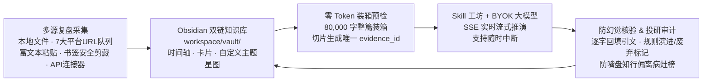

# TradeLoom · 织脉 (`v0.6.0`)

> **Local-first 投研复盘双向链接知识库 & 个人交易方法论演化引擎**  
> 将散落在本地文档（`.md / .txt / .docx / .html / .pdf`）与主流云端平台（雪球 / 微信公众号 / 语雀 / 飞书 / Notion / 有道云笔记 / 印象笔记 / 滴答清单）的零散交易复盘，编织为 **Obsidian 原生双链星图**；通过 **逐字证据防幻觉校验** 与 **分层 Map-Reduce 跨周期综合**，提炼阶段认知时间轴、可证伪的个人交易手册与**防“嘴盘”知行偏离病灶榜**。

[](./LICENSE)
[](https://nodejs.org/)
[](#安全与隐私边界)

---

## 为什么做 TradeLoom？

大多数交易者写了几百篇盘后日记，最终却变成“只写不看”的流水账；直接把几十篇笔记丢给通用大模型总结，又会遭遇三大痛点：

1. **幻觉与正确的废话**：大模型随意脑补原文没做过的标的、胜率与收益数字，输出千篇一律的教科书套话；
2. **长周期上下文截断**：1~2 年的日度实盘记录动辄十几万字，单次对话塞不下，无法看清跨牛熊周期的方法论自我迭代；
3. **“嘴盘”与幸存者偏差**：复盘里写了十遍“严禁满仓加融资、破位必止损”，实盘却反复重仓硬扛——传统总结工具会把口号当成铁律，掩盖真实的亏损病灶。

**TradeLoom 的解法：**



---

## 核心特性

### 1. 全渠道复盘无损汇聚（本地 + 云端双引擎）
- **本地多格式直传**：支持 `.md`、`.txt`（自动识别 UTF-8 / GB18030 中文编码）、`.docx`、`.html`、`.pdf`（内嵌阅读并按页提取文本）。
- **7 大平台公开链接直抓 + 批量防限流队列**：深度适配 **雪球**（含转发原帖与 `+08:00` 时区校正）、**微信公众号**、**语雀**、**飞书公开文档**、**Notion 公开页**、**有道云笔记**、**印象笔记**；支持一次粘贴最多 **50 条 URL** 自动按域名礼貌节流排队、雪球访客 Cookie 预热与阿里云 WAF 指数退避重试，整批完成后单次重建双链。
- **富文本粘贴 & 专业复盘模板**：支持从任意网页 `Ctrl+C / Ctrl+V` 自动还原标题/列表/表格为 Markdown；内置 **《盘前计划 vs 盘后执行》**、**《趋势/周期持仓跟踪》**、**《大亏反例深度解剖》** 一键插入模板。
- **零密码风险浏览器剪藏 & 官方 API 连接器**：内置带 `X-TradeLoom-Clip-Token` 本地令牌保护的书签剪藏工具（专治登录墙页面），并提供 **Notion / 飞书 / 语雀 / 滴答清单** 官方 API 批量同步面板。

### 2. Obsidian 原生双向链接工作台与全息阻尼星图
- 生成纯正本地 Markdown 目录（`00-总览.md`、`10-时间轴/`、`20-卡片/`、`30-主题/`、`40-交易手册/`），支持**一键打包导出 `.zip`** 直接拖入桌面版 Obsidian 无缝使用。
- **全息力导向关系星图**：架构级分层引力布局 + 阻尼拖拽物理手感；**单击节点高亮一度关联结构网络，再次单击聚焦节点直达详情**。
- **自定义主题词典 & 未链接提及（Unlinked Mentions）**：可在网页内自由增删改自己的交易概念词与触发关键词（保存至 `workspace/concepts.json`），一键重排全库双链；支持单篇安全移入本地回收站（`workspace/.trash/`）与一键清理演示样本。

### 3. 投研级提炼引擎：防幻觉 · Map-Reduce · 规则证伪 · 防“嘴盘”审计
- **强证据溯源防幻觉**：服务端预先对原文切片生成 `evidence_id`，模型只允许引用目录内合法 ID；服务端逐字回填真实原文并自动剔除一切无据幻觉。
- **分层二次综合（Map-Reduce）**：面对横跨数年的百篇日度碎片的场景，支持先按月/季生成阶段手册，再勾选多份阶段手册跨周期二次综合出年度总纲或终极个人交易手册，轻松突破单次 `80,000` 字上下文窗口。
- **规则生命周期与冲突演进检测**：自动为每条规则标注 `✓ 持续验证有效`、`↻ 认知迭代升级` 或 `⚠ 已证伪废弃（反面警示）`，显式呈现新旧认知如何演进与推翻。
- **知行偏离与重复违纪病灶榜（防“嘴盘”照妖镜）**：专门对照作者口头立下的纪律（Stated Rule）与实盘真实发生的违纪行为（Actual Deviation），绑定违纪现场原文证据并给出硬性物理阻断条款。
- **SSE 流式实时进度与随时中断**：实时展示切片装箱、模型推理/输出字数与核验状态，支持随时点击中断请求。

### 4. 可视化「分析 Skill 工坊」
- 开箱内置 **5 套只读保护框架**：`综合阶段归纳`、`短线博弈 Skill（五层判断链）`、`基本面分析 Skill（五维框架）`、`趋势波段与盈亏比管理 Skill（美港股/期货/Crypto 通用）`、`资源周期与仓位杠杆风控 Skill`。
- 在 `/settings?tab=skills` 提供可视化编辑器：支持**一键克隆内置 Skill 魔改**、**新建空白 Skill**、**源码/预览实时切换**，自动隔离保存至 `workspace/skills/*.md`。

---

## 快速开始（3 种方式任选）

### 方式 A：双击脚本一键启动（推荐非程序员交易员，需已安装 [Node.js 20+](https://nodejs.org/)）
- **Windows**：双击运行 `scripts\start-windows.bat`（自动检查依赖、完成生产构建并打开 `http://127.0.0.1:3200`）。
- **macOS**：终端赋予一次执行权限 `chmod +x scripts/start-mac.command` 后双击运行。

### 方式 B：Docker 一条命令启动（免配置本机 Node 环境）
```bash
git clone <your-repo-url> tradeloom
cd tradeloom
docker compose up -d
```
访问 `http://127.0.0.1:3200`，所有个人复盘、双链卡片、API Key 与自定义 Skill 均持久化在宿主机 `./workspace` 目录中。

### 方式 C：开发者源码运行
```bash
git clone <your-repo-url> tradeloom
cd tradeloom
pnpm install
pnpm dev
```

### 上手四步曲
1. 打开 `http://127.0.0.1:3200`，可先点击 **「加载 6 篇示例复盘」** 体验星图与提炼流程，体验完毕后点击左侧 **「一键清理 6 篇演示样本」** 即可干净清空；
2. 点击左侧 **「云端」** 或 **「本地」** 导入你的历史复盘笔记；
3. 前往 **「设置 → 大模型 API」** 填入 DeepSeek / OpenAI / 硅基流动或本机 Ollama 接口（自动补全 `/v1/chat/completions`），并在 **「分析 Skill 工坊」** 或 **「自定义主题词典」** 按你的交易流派微调；
4. 前往 **「阶段提炼」**，按月/季提炼阶段手册，再用 **「阶段手册二次综合 · Map-Reduce」** 合成跨年度个人交易总纲。

---

## 安全与隐私边界

- **100% Local-First 离线优先**：无云端数据库、无遥测埋点、无账号体系。所有源文件、Obsidian 卡片、API Key（`workspace/config.json`）、连接器凭证（`workspace/connectors.json`）与自定义 Skill（`workspace/skills/`）均存储在本地 `workspace/`（已加入 `.gitignore`）。
- **本地服务安全护栏**：默认仅监听回环地址 `127.0.0.1:3200`（**请勿将本服务无鉴权直接暴露至公网 `0.0.0.0`**）；外发网页抓取内置 URL 协议白名单 + **DNS A/AAAA 私网解析拦截（防 DNS Rebinding SSRF）**；浏览器书签剪藏接口强制校验本地随机生成的 `X-TradeLoom-Clip-Token`，杜绝第三方网页跨站注入。

---

## 演进路线图（Roadmap）

详见 [ROADMAP.md](./ROADMAP.md)：
- [x] **Sprint 1**：本地剪藏令牌鉴权、DNS 级防 SSRF、回收站删改闭环、Vault `.zip` 导出、Docker 与 CI 工程化
- [x] **Sprint 2**：规则生命周期（持续有效 / 认知迭代 / 已证伪废弃）、防“嘴盘”知行偏离审计、跨市场趋势/周期内置 Skill、SSE 流式提炼与中断
- [ ] **Sprint 3**：券商交割单 / 每日净值 `.csv` 挂载，时间轴叠加客观回撤与胜率盈亏比，实现定性复盘 × 定量绩效交叉证伪
- [ ] **Sprint 4**：千篇级 `sha256` 增量解析缓存与本地敏感凭证 AES-256-GCM 主口令静态加密

---

## 开发与验证

```bash
pnpm run typecheck   # TypeScript 严格静态类型检查
pnpm run test        # 运行全部 Vitest 单元测试
pnpm run build       # Next.js 生产构建校验
```

---

## 免责声明与开源协议

- **金融合规免责声明**：TradeLoom 仅作为个人历史交易记录的结构化归档、知识检索与自我纪律审计工具，**不提供任何证券、期货、基金或加密资产的投资建议、行情预测或买卖信号**。市场有风险，交易决策责任完全由用户自行承担。
- 本项目基于 [MIT License](./LICENSE) 开源，欢迎提交 Issue、PR 与交易流派 Skill 模板。