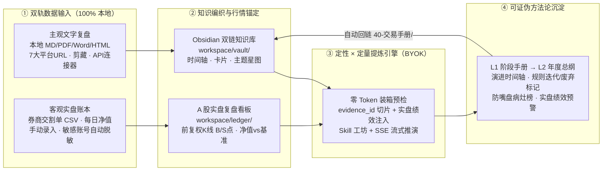

# TradeLoom · 织脉 (`v0.7.0`)

> **Local-First 投研复盘双链知识库 × A 股实盘投资账本 × 个人交易方法论演化引擎**  
> 将散落在本地文档与各大云端笔记平台的交易复盘，编织为 **Obsidian 原生双链星图**；挂载真实 **A 股交割单、每日净值与前复权 K 线买卖点**；通过 **逐字证据防幻觉校验**、**定性 × 定量交叉证伪** 与 **L1→L2 分层综合（Map-Reduce）**，沉淀属于你自己的个人交易手册与防“嘴盘”纪律审计体系。

[](./package.json)
[](./LICENSE)
[](https://nextjs.org/)
[](#七安全与隐私边界)
[](#四快速开始按人群任选-4-种方式)

---

## 目录

- [一、为什么做 TradeLoom？](#一为什么做-tradeloom)
- [二、六大工作台一览](#二六大工作台一览)
- [三、核心功能体系](#三核心功能体系)
  - [1. A 股实盘投资账本与行情买卖点复盘](#1-a-股实盘投资账本与行情买卖点复盘)
  - [2. 全渠道文字复盘汇聚与 Obsidian 双链星图](#2-全渠道文字复盘汇聚与-obsidian-双链星图)
  - [3. 定性 × 定量交叉审计与 L1→L2 方法论演化引擎](#3-定性--定量交叉审计与-l1l2-方法论演化引擎)
  - [4. 可视化「分析 Skill 工坊」](#4-可视化分析-skill-工坊)
- [四、快速开始（按人群任选 4 种方式）](#四快速开始按人群任选-4-种方式)
- [五、5 分钟上手工作流](#五5-分钟上手工作流)
- [六、项目结构与本地数据布局](#六项目结构与本地数据布局)
- [七、安全与隐私边界](#七安全与隐私边界)
- [八、演进路线图与开发验证](#八演进路线图与开发验证)
- [九、免责声明与开源协议](#九免责声明与开源协议)

---

## 一、为什么做 TradeLoom？

大多数交易者写了几百篇盘后日记，最终却变成“只写不看”的流水账；而直接把历史笔记丢给通用大模型总结，又往往踩中四个硬伤：

| 传统复盘痛点 | TradeLoom 的工程解法 |
| :--- | :--- |
| **文字与盈亏割裂**：复盘写得头头是道，却分不清是牛市 Beta 还是真 Alpha，也看不清个股买卖点是否高买低卖 | **实盘账本 × A 股真实行情**：导入券商交割单/日度净值，在前复权 K 线上精准标注 `B/S` 买卖节点，并叠加沪深300等市场基准曲线 |
| **大模型幻觉与套话**：随意脑补原文没做过的标的、胜率与收益，输出教科书式废话 | **服务端逐字证据核验**：预切片分配 `evidence_id`，模型只能引用合法 ID，服务端逐字回填真实原文并剔除一切无据幻觉 |
| **长周期上下文截断**：1~2 年日度复盘动辄十几万字，单次对话装不下，看不到认知演进 | **L1 → L2 分层综合（Map-Reduce）**：先按月/季提炼 L1 阶段手册，再跨周期二次综合为 L2 年度总纲，构建二层方法论档案树 |
| **“嘴盘”与幸存者偏差**：日记里十次立 Flag“严禁追高满融”，实盘却反复违纪硬扛 | **防“嘴盘”病灶榜 + 实盘盈亏证伪**：对比口头规则与违纪现场证据；若某战法所在阶段净值大幅回撤或盈亏比 `< 1`，自动触发绩效存疑预警 |

### 端到端投研复盘闭环



---

## 二、六大工作台一览

| 页面路由 | 核心定位 | 关键交互与产出 |
| :--- | :--- | :--- |
| **`/` 关系星图** | 全局认知鸟瞰 | 全息阻尼力导向星图（单击高亮一度关联、再次单击直达详情）、核心统计指标、一键体验演示样本 |
| **`/vault` 复盘知识库** | 笔记管理与时间轴 | 时间轴卡片（同日自动挂载实盘盈亏徽章）、本地/云端导入、单篇安全移入回收站、一键导出 Obsidian `.zip` |
| **`/ledger` 实盘投资账本** | A 股账户与个股复盘 | 净值 vs 市场基准对比曲线、个股真实前复权日 K 线 + `B/S` 买卖点叠加、交割单 CSV 脱敏导入、每日手动录入 |
| **`/synthesize` 阶段提炼** | 方法论归纳工坊 | 深色日期框选 + 底部 `全选/反选/清空`、单阶段 L1 提炼、跨周期 L2 二次综合（Map-Reduce）、SSE 实时流式进度与随时取消 |
| **`/manuals` 交易手册馆** | 二层方法论档案库 | **L2 年度总纲 → 嵌套 L1 阶段手册**二层树状结构、可展开/收起的时间轴原文依据、规则演进状态与知行偏离病灶榜 |
| **`/settings` 系统设置** | 引擎与流派定制 | BYOK 大模型配置（DeepSeek / OpenAI / 硅基流动 / Ollama）、可视化 Skill 工坊、自定义主题词典、云端 API 连接器 |

---

## 三、核心功能体系

### 1. A 股实盘投资账本与行情买卖点复盘

专为 A 股实战交易者打造的专业级本地投资账本，无需付费行情接口、不上传资金明细：

- **多通道账本录入**：
  - **券商交割单 / 每日净值 `.csv / .tsv` 导入**：自动识别 UTF-8 / GB18030 中文编码，智能映射常见券商列名（日期、证券代码/名称、买卖方向、成交价/数量/金额、仓位、当日盈亏/净值），并在预览与落盘阶段**自动脱敏资金账号、股东代码、客户号等敏感字段**。
  - **每日手动快录**：支持快速补录单笔买卖或当日净值快照，输入代码或拼音/简称自动联想匹配 A 股标的。
- **个股真实日 K 线 × `B/S` 交易节点叠加**：
  - 直连东方财富 / 腾讯财经公开行情获取 A 股真实前复权日 K 线（本地缓存至 `workspace/ledger/market-cache/`），在个股走势图上直观还原每一笔买入 `B` 与卖出 `S` 节点、持仓成本与波段盈亏。
- **账户净值曲线与风险指标聚合**：
  - 支持叠加 **沪深 300 / 中证 500 / 上证指数 / 创业板指** 等市场基准曲线，自动计算区间收益率、最大回撤（MDD）、实盘胜率、盈亏比（Profit Factor）与最高仓位/融资暴露。

### 2. 全渠道文字复盘汇聚与 Obsidian 双链星图

- **本地 5 格式无损解析**：支持 `.md`、`.txt`（自动编码探测）、`.docx`、`.html`、`.pdf`（内嵌预览 + 按页提取文本）。
- **7 大平台公开链接队列抓取**：深度适配 **雪球**（含转发原帖与 `+08:00` 时区校正）、**微信公众号**、**语雀**、**飞书公开文档**、**Notion 公开页**、**有道云笔记**、**印象笔记**；单次支持粘贴最多 **50 条 URL**，按域名礼貌节流排队、雪球访客预热与 WAF 退避重试，整批完成后单次重建双链。
- **富文本粘贴与专业模板**：任意网页 `Ctrl+C / Ctrl+V` 自动还原 Markdown 结构；内置 **《盘前计划 vs 盘后执行》**、**《趋势/周期持仓跟踪》**、**《大亏反例深度解剖》** 模板。
- **浏览器安全剪藏 & 官方 MCP / API 连接器**：提供带本地随机令牌（`X-TradeLoom-Clip-Token`）的书签剪藏工具；原生支持 **滴答清单 / TickTick & Notion 官方远程 MCP 一键 OAuth 登录**、**有道云笔记官方 MCP (SSE) 目录点选与全文检索同步**，**飞书扫码一键创建应用 (RFC 8628) + 本机 `lark-cli` 自动搜索与原生 Markdown 导出**，**腾讯文档** 官方远程 MCP（免费 2,000 次/天，覆盖知识库空间与云文档）、**腾讯 ima** 官方 OpenAPI（笔记本 + 知识库双通道免费同步）、**Microsoft OneNote**（Windows 桌面版原生 COM 免注册零配置直连，无需 Azure/Word/Pandoc），以及 **语雀** 官方 API v2（知识库胶囊点选、语雀小记拉取、跨库全文检索与团队空间自动归一化；免费用户支持剪藏/导出 MD 无痛导入）。
- **Obsidian 原生输出**：目录严格按 `00-总览.md`、`10-时间轴/`、`20-卡片/`、`30-主题/`、`40-交易手册/` 组织；支持网页内维护自定义概念词典（`workspace/concepts.json`）与未链接提及识别，一键打包 `.zip` 即可在桌面版 Obsidian 打开。

### 3. 定性 × 定量交叉审计与 L1→L2 方法论演化引擎

- **全链路 4 处定量交叉核验**：
  1. 知识库时间轴卡片自动挂载同日客观盈亏、仓位与基准超额徽章；
  2. 阶段提炼前自动汇总区间客观净值与交割绩效，作为只读事实注入分析上下文；
  3. 当提炼出的“得意战法”在对应周期实盘显著回撤或盈亏比 `< 1` 时，自动触发 **`[实盘绩效存疑预警]`**；
  4. 同步写入 Obsidian 的 `40-交易手册/` 自动附带定量绩效核验区块。
- **防幻觉与清爽阅读体验**：
  - 服务端预先切分证据并校验模型返回的每一条 `evidence_id`，逐字回填真实原文；
  - 方法论演变时间轴下方的原文依据默认折叠收起，支持单节点或顶部一键展开核查，兼顾宏观阅读效率与细节溯源。
- **二层手册档案结构（L2 总纲 → L1 阶段）**：
  - 突破单次上下文限制，先按月/季生成 L1 阶段手册，再勾选多份阶段手册二次综合为 L2 年度总纲；
  - `/manuals` 页面以清晰的二层树展示 **L2 总纲与下属 L1 子手册** 的归属关系，未归并的独立 L1 手册分区管理。
- **规则生命周期 & 防“嘴盘”病灶榜**：
  - 每条规则明确标注 `✓ 持续验证有效`、`↻ 认知迭代升级` 或 `⚠ 已证伪废弃` 及冲突演进说明；
  - 专门审计“口头立下的纪律 vs 实盘重复违纪行为”，绑定多日原文证据并给出可执行的物理风控条款。

### 4. 可视化「分析 Skill 工坊」

- 内置 **5 套只读保护交易流派框架**：
  1. `综合阶段归纳`（默认通用框架）
  2. `短线博弈 Skill`（情绪周期 / 主线梯队五层判断链）
  3. `基本面分析 Skill`（景气 / 竞争格局 / 现金流 / 估值五维框架）
  4. `趋势波段与盈亏比管理 Skill`（兼容美港股、期货、Crypto）
  5. `资源周期与仓位杠杆风控 Skill`（供需拐点与融资去杠杆纪律）
- 在 `/settings?tab=skills` 支持**一键克隆内置 Skill 魔改**、**新建自定义 Skill**、源码/预览切换，独立持久化于 `workspace/skills/*.md`。

---

## 四、快速开始（按人群任选 4 种方式）

### 方式 1：Windows 便携版双击启动（推荐非程序员 / 试用用户，零依赖）

无需安装 Node.js、Git 或任何开发工具（压缩包约 **63 MB**，已内置独立 `runtime/node.exe`）：

1. 下载最新发行包 `TradeLoom-v0.7.0-win-x64.zip`；
2. 解压至**本地普通目录**（如桌面或 `D:\TradeLoom`，请勿放在受限沙箱目录中）；
3. 双击 **`TradeLoom.exe`**，2~5 秒后自动弹出深色控制面板并拉起独立应用窗口；
4. 所有个人复盘、账本和配置均保存在同级 `workspace/` 目录内，随时打包带走。

> 💡 若你正在使用本仓库源码，可执行 `pnpm run pack:win` 一键重新编译 `TradeLoom.exe` 并生成干净无隐私的 Windows 便携分发压缩包（输出至 `dist/TradeLoom-v0.7.0-win-x64.zip`）。

### 方式 2：直接交给 AI Agent 启动（适合 Claude Code / Codex / OpenClaw 等技术用户）

便携包内已预置面向 AI Agent 的标准启动协议（`AGENT_START.md`、`start-agent.ps1`、`stop-agent.ps1`）。把压缩包解压路径丢给 Agent 并说“帮我启动 TradeLoom”，Agent 只需执行：

```powershell
powershell -ExecutionPolicy Bypass -File .\start-agent.ps1
```

脚本会自动选定空闲端口、后台拉起本地服务并返回结构化 JSON（包含 `url`、`pid`、`workspace`）；停止时执行 `.\stop-agent.ps1` 即可优雅关闭。

### 方式 3：Docker Compose 一键运行（Windows / macOS / Linux 通用）

```bash
git clone <your-repo-url> tradeloom
cd tradeloom
docker compose up -d
```

访问 `http://127.0.0.1:3200`，个人数据持久化挂载于宿主机 `./workspace`。

### 方式 4：开发者源码运行（需 [Node.js 20+](https://nodejs.org/) 与 `pnpm`）

```bash
git clone <your-repo-url> tradeloom
cd tradeloom
pnpm install
pnpm dev
```

也可直接双击仓库自带脚本快速启动：Windows 运行 `scripts\start-windows.bat`，macOS 执行 `chmod +x scripts/start-mac.command` 后双击启动。

---

## 五、5 分钟上手工作流

1. **零门槛体验**：打开 `http://127.0.0.1:3200`，点击 **「加载 6 篇示例复盘」** 直观体验双链星图与提炼；体验完成后点击左侧 **「一键清理演示样本」** 干净清空。
2. **双轨导入数据**：
   - 在 **「复盘知识库」** 导入历史 Markdown / PDF / Word 复盘或云端平台链接；
   - 在 **「实盘账本 (`/ledger`)」** 导入券商交割单 CSV 或手动录入交易，立刻在真实 A 股 K 线上看到自己的 `B/S` 买卖点。
3. **配置大模型（BYOK）**：前往 **「设置 → 大模型 API」** 填入任意 OpenAI 兼容接口（DeepSeek / OpenAI / 硅基流动 / 本地 Ollama 等，自动补全 `/v1/chat/completions`），按流派微调 Skill 与主题词典。
4. **提炼与演化**：进入 **「阶段提炼 (`/synthesize`)」**，用日期框选或一键全选生成 L1 阶段手册，再将多份阶段手册二次综合为 L2 年度总纲，前往 **「交易手册馆 (`/manuals`)」** 检视二层方法论档案树与防“嘴盘”审计结果。

---

## 六、项目结构与本地数据布局

```text
tradeloom/
├── src/
│   ├── app/                  # Next.js 15 App Router（6 大工作台页面 + 本地 API）
│   ├── components/           # 星图、账本 K 线、净值曲线、提炼面板、二层手册树等组件
│   ├── lib/                  # 双链构建、交割单与行情引擎、防幻觉提炼、云端采集、Skill 管理
│   └── types/                # TypeScript 核心领域类型定义
├── skills/                   # 5 套只读内置交易流派 Skill 模板
├── samples/                  # 6 篇内置演示复盘样本
├── scripts/                  # 启动脚本、WinForms 便携启动器源码与一键打包脚本
├── __tests__/                # Vitest 单元测试与冷启动完整性测试（10 套件 / 38 用例）
└── workspace/                # 【已 .gitignore】全部用户私有数据（单目录可备份迁移）
    ├── sources/              # 原始导入文件（PDF/DOCX/MD/TXT/HTML）
    ├── vault/                # 生成的 Obsidian 原生双链目录（含 40-交易手册/）
    ├── ledger/               # 脱敏交割单、每日净值与 A 股行情本地缓存
    ├── manuals/              # L1 阶段手册与 L2 二次综合手册 JSON 档案
    ├── skills/               # 用户自定义/魔改 Skill
    ├── concepts.json         # 自定义主题词典
    ├── config.json           # 本地大模型 API 配置（仅存于本机）
    └── .trash/               # 删除文档的本地回收站
```

---

## 七、安全与隐私边界

- **100% Local-First 离线优先**：无云端数据库、无账号体系、无行为埋点。所有私有复盘、交割单、API Key 与自定义 Skill 均保存在本地 `workspace/`（已加入 `.gitignore`，且便携打包脚本内置隐私门禁，构建时严格排除 `workspace/`）。
- **交割单敏感字段脱敏**：CSV 解析器在预览与落盘阶段自动屏蔽资金账号、股东代码、客户编号等敏感列，避免敏感账户信息进入本地文件或大模型上下文。
- **本地网络安全护栏**：
  - 默认仅绑定回环地址 `127.0.0.1`（**请勿无鉴权暴露至公网 `0.0.0.0`**）；
  - 云端链接抓取内置 URL 协议白名单与 **DNS A/AAAA 私网解析拦截（防 DNS Rebinding SSRF）**；
  - 浏览器书签剪藏接口强制校验本地随机令牌 `X-TradeLoom-Clip-Token`，杜绝第三方网页跨站注入。

---

## 八、演进路线图与开发验证

完整迭代规划详见 [ROADMAP.md](./ROADMAP.md)：

- [x] **Sprint 1**：剪藏令牌鉴权、DNS 级防 SSRF、回收站删改闭环、Vault `.zip` 导出、Docker 与 CI 工程化
- [x] **Sprint 2**：规则生命周期（持续有效 / 认知迭代 / 已证伪废弃）、防“嘴盘”知行偏离审计、跨市场内置 Skill、SSE 流式提炼与取消
- [x] **Sprint 3**：A 股实盘投资账本、真实前复权日 K 线 `B/S` 买卖点、净值 vs 市场基准曲线、交割单脱敏导入与定性 × 定量交叉证伪、Windows 零依赖便携包与 AI Agent 启动协议
- [ ] **Sprint 4**：千篇级 `sha256` 增量解析缓存、本地凭证 AES-256-GCM 主口令可选静态加密

### 本地开发与质量校验

```bash
pnpm run typecheck   # TypeScript 严格静态类型检查
pnpm run test        # 运行全部 Vitest 单元测试（10 套件 / 38 用例）
pnpm run build       # Next.js 生产构建校验
pnpm run pack:win    # 一键打包 Windows 零依赖便携版 ZIP
```

---

## 九、免责声明与开源协议

- **金融合规免责声明**：TradeLoom 仅作为个人历史交易记录的结构化归档、行情对照复盘、知识检索与自我纪律审计工具，**不提供任何证券、期货、基金或加密资产的投资建议、行情预测或买卖信号**。市场有风险，交易决策责任完全由用户自行承担。
- 本项目基于 [MIT License](./LICENSE) 开源，欢迎提交 Issue、PR 与交易流派 Skill 模板。