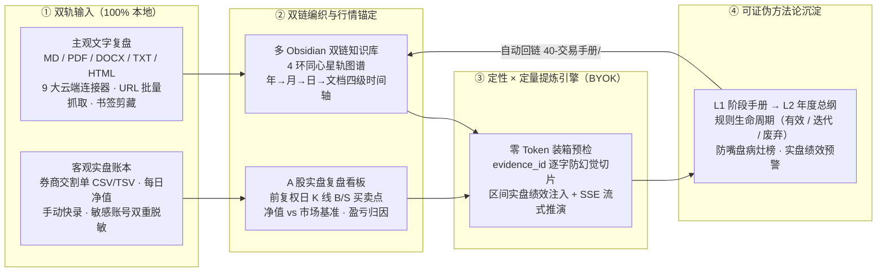

<div align="center">


# TradeLoom · 织脉

**Local-First 投研复盘双链知识库 × A 股实盘投资账本 × 个人交易方法论演化引擎**

将散落在本地文档与 **9 大主流云端笔记平台** 的盘后复盘，自动编织为 **Obsidian 原生双链星轨图谱**；  
挂载真实 **A 股交割单、每日净值与前复权 K 线 `B/S` 买卖点**；  
通过 **逐字证据防幻觉核验**、**定性 × 定量交叉证伪** 与 **L1 → L2 分层综合（Map-Reduce）**，  
沉淀可回溯、可证伪、防“嘴盘”的个人交易手册体系。

[](./package.json)
[](./LICENSE)
[](./package.json)
[](https://nextjs.org/)
[](#2-全渠道复盘汇聚与-9-大云端连接器矩阵)
[](#七安全与隐私红线)

[为什么做 TradeLoom](#一为什么做-tradeloom) · [核心特性](#二核心功能体系) · [工作台路由](#三多库并行与八大工作台) · [快速开始（4 种方式）](#四快速开始按人群任选-4-种方式) · [5 分钟闭环](#五5-分钟上手闭环) · [安全与隐私](#七安全与隐私红线)

<br />


</div>

---

## 一、为什么做 TradeLoom？

大多数交易者写了几百篇盘后复盘，最终却沦为“只写不看”的流水账；而直接把历史笔记丢给通用大模型总结，往往踩中四大硬伤：

| 传统复盘痛点 | TradeLoom `v1.0.0` 的工程解法 |
| :--- | :--- |
| **文字与盈亏割裂**：复盘写得头头是道，却分不清是牛市 Beta 顺风还是真实 Alpha，也看不清个股是否反复高买低卖 | **实盘账本 × A 股真实行情**：导入券商交割单与日度净值，在前复权日 K 线上精准锚定每一笔 `B/S` 买卖点，叠加沪深300 / 科创50 / 中证1000 等基准曲线自动核算超额收益与最大回撤 |
| **大模型幻觉与套话**：凭空捏造没做过的标的、胜率与收益，输出毫无实战价值的教科书式空话 | **服务端逐字证据核验（Zero-Hallucination）**：服务端预先将复盘原文切分为带 `evidence_id` 的证据片段；模型仅允许引用合法 ID，落盘前由服务端逐字回填真实原文并剔除一切无据幻觉 |
| **多年长周期上下文截断**：3~5 年日/周/月/季/年度复盘动辄十余万字，单次对话装不下，看不到认知演进脉络 | **L1 → L2 分层综合（Map-Reduce）**：单次支持最多 **300 篇** 按时间正序装箱预检；先按月/季生成 L1 阶段手册，再跨周期二次综合为 L2 年度总纲，构建二层方法论演化树 |
| **“嘴盘”与幸存者偏差**：日记里十次立 Flag“严禁追高满融”，实盘却反复违纪硬扛 | **防“嘴盘”病灶榜 + 实盘盈亏交叉证伪**：强制绑定多日违纪原文证据揪出高频知行偏离；若某“得意战法”所在周期净值显著回撤或盈亏比 `< 1`，自动触发 **`[实盘绩效存疑预警]`** |

### 端到端投研复盘闭环架构



---

## 二、核心功能体系

### 1. 多 Obsidian 双链知识库引擎 & 4 环同心星轨图谱

- **多知识库并行隔离**：不同交易账户、策略流派（短线接力 / 趋势波段 / 基本面深度）或名家历史语料研究彼此完全独立，支持直接**外挂本地已有 Obsidian Vault 文件夹**，零迁移成本。
- **全息 4 环同心星轨图谱（Orbital Star Map）**：告别传统力导向图上百节点缠绕成“毛线团”的痛点，严格按投研知识层级解耦为 4 层 360° 同心星轨：
  - **中心总枢纽**：`00-总览.md (MOC)`；
  - **`ORBIT 01` 主题星核环**：核心交易概念与策略标签（如 `#仓位与风控纪律`、`#量能与资金流`），并与年度/月度时间索引双向贯通；
  - **`ORBIT 02` 年度档案环** & **`ORBIT 03` 月度时间索引环**：按年份扇区辐射展开时间脉络；
  - **`ORBIT 04` 复盘原件卡片外环**：支持顶栏一键切换 **「骨架脉络 / 全量展开」**，悬停或单击任一节点即时点亮跨层关联光路与右侧局部神经星图。
- **四级可折叠时间轴导航树**：左侧浏览器原生支持 **`年 → 月 → 日 → 复盘文档`** 四层穿透折叠，跨 5 年、130+ 篇日/周/月/季/年全粒度复盘亦可一键定位，全量双链并发重建仅需 **`~275ms`**。
- **纯正 Obsidian 原生结构**：自动维护 `00-总览.md`、`10-时间轴/`、`10-每日/`、`20-卡片/`、`30-主题/`、`40-交易手册/` 与未链接提及（Unlinked Mentions）扫描，支持全窗口拖拽上传与一键导出 `.zip`。

### 2. 全渠道复盘汇聚与 9 大云端连接器矩阵

一次全局授权，同步时可自由指定写入任意目标知识库：

| 平台 | 接入协议 / 认证模式 | 核心同步能力 |
| :--- | :--- | :--- |
| **滴答清单 / TickTick** | 官方远程 MCP · 一键 OAuth 2.0 (PKCE) | 自动发现清单列表、多清单点选、过滤系统欢迎任务、同步盘后复盘笔记 |
| **Notion** | 官方远程 MCP OAuth / Integration Token | 支持一键登录或指定 Database / Page URL 及全文搜索，完整还原块级 Markdown |
| **飞书文档 / Lark** | RFC 8628 扫码一键建应用 + 本机 `lark-cli` 双模 | 免开后台扫码即建自建应用，或直连本机 `lark-cli` 自动检索个人云文档与知识库 |
| **有道云笔记** | 官方远程 MCP (SSE) · 单 API Key | 无需部署额外中间件，支持目录树浏览点选与关键词检索同步 |
| **腾讯文档** | 官方远程 MCP（免费 2,000 次/天） | 覆盖知识库空间与云盘目录，支持空间/文件夹多选过滤 |
| **腾讯 ima** | 官方 OpenAPI 双通道（免费） | 同时打通「个人笔记本」与「ima 知识库」双通道检索拉取 |
| **Microsoft OneNote** | Windows 桌面版原生 COM 零配置直连 | **免注册 Azure、免填密钥、免装 Word/Pandoc**，本机直接解析分区与表格为干净 Markdown |
| **语雀** | 官方 Open API v2 | 自动拉取个人/团队空间知识库与语雀小记，支持知识库胶囊多选与关键词过滤 |
| **印象笔记 · 国内版** | 官方 Skill RESTful API（1 年期令牌） | 支持笔记本与标签筛选及全文检索；免费版提供导出 `.html` 批量拖拽无损导入引导 |

此外还内置：
- **公开网页 URL 批量抓取队列**：深度适配 **雪球**（含转发原帖与北京时间校正）、**新浪财经博客**、**微信公众号**、**语雀/飞书/Notion 公开页**，单次支持粘贴最多 **50 条链接** 礼貌节流抓取，整批完成后单次极速重建索引。
- **富文本粘贴 & 浏览器书签一键剪藏**：任意登录态网页选中正文点一下书签栏即可通过本地令牌（`X-TradeLoom-Clip-Token`）安全剪藏入库；内置《盘前计划 vs 盘后执行》《趋势/周期持仓跟踪》《大亏反例深度解剖》专业模板。

### 3. A 股实盘投资账本与行情买卖点复盘

- **券商交割单 & 每日净值无痛导入**：兼容 **UTF-8 / GB18030 / UTF-16LE / TSV** 等主流券商导出格式，支持拖拽上传与自定义列映射；在预览与入库双阶段**强制脱敏资金账号、股东代码、委托/流水号、身份证等敏感列**。
- **真实前复权日 K 线 × `B/S` 买卖点叠加**：直连东方财富 / 腾讯财经公开接口获取沪深北 A 股及可转债前复权日线（本地缓存于 `market-cache/`，自动识别除权除息漂移并刷新复权价），在 K 线上直观复盘每笔建仓、加减仓与清仓点位及跨期真实持仓成本。
- **净值 vs 市场基准量化看板**：支持切换 **沪深300 / 上证指数 / 创业板指 / 科创50 / 中证1000**，自动统计累计收益、超额 Alpha、最大回撤（MDD）、日胜率、盈亏比（Profit Factor）、最高仓位与融资天数。

### 4. 定性 × 定量交叉审计与可视化 Skill 工坊

- **全链路 4 处定量交叉核验**：
  1. 知识库每日卡片自动挂载同日账户盈亏、仓位与超额收益徽章；
  2. 阶段提炼自动注入区间客观绩效摘要（严格仅传百分比与比率，**零人民币绝对金额外发**）；
  3. 战法所在周期若实盘大幅回撤或盈亏比 `< 1`，自动生成 **`[实盘绩效存疑预警]`**；
  4. 生成的手册自动回写至 Obsidian `40-交易手册/`，无缝纳入双链图谱。
- **内置 5 套只读流派 Skill + 可视化工坊**：涵盖 `综合阶段归纳`、`短线情绪博弈`、`基本面五维分析`、`趋势波段与盈亏比管理`、`资源周期与仓位杠杆风控`，支持在 `/settings?tab=skills` 一键克隆魔改或新建专属分析框架。
- **现代投研极简双主题 UI**：默认采用**护眼暖白纸底（`#f7f6f3`）+ 炭墨字 + 矿石板岩蓝主色（`#2d5f8b`）**，顶栏一键切换低反差柔炭深色模式，长时阅读零炫光疲劳。

---

## 三、多库并行与八大工作台

| 页面路由 | 作用域 | 核心定位 | 关键能力与产出 |
| :--- | :---: | :--- | :--- |
| **`/` 工作台概览** | 本库 | 新手引导与状态中枢 | 全新安装提供「一键体验独立示范库 `demo-sandbox`」与「30 秒建库」双通道；日常打开直达 4 步进度、多年时间轴与最新手册 |
| **`/vault` 复盘与星图** | 本库 | 双链阅读与全息星图 | 四级时间轴树、4 环同心星轨双链图谱、拖拽导入、库内专属概念词典编辑器、卡片原文在线编辑与 `.zip` 导出 |
| **`/ledger` 本库账本** | 本库 | 实盘净值与个股 K 线 | 净值 vs 基准收益曲线、最大回撤水下曲线、个股前复权日 K 线 `B/S` 买卖点复盘、券商 CSV/TSV 脱敏导入 |
| **`/synthesize` 提炼方法论** | 本库 | L1 / L2 归纳工坊 | 日期区间框选、零 Token 装箱预检、单阶段 L1 提炼、多手册 L2 二次综合（Map-Reduce）、SSE 实时流式进度与取消 |
| **`/manuals` 交易手册馆** | 本库 | 二层方法论档案库 | **L2 年度总纲 → 嵌套 L1 阶段手册**、原文证据折叠溯源、规则演进生命周期标记、防“嘴盘”知行偏离审计榜 |
| **`/vaults` 全部知识库** | 全局 | 多库并行管理大厅 | 卡片化管理全部知识库（新建、流派词典模板、外挂本地 Obsidian 目录、默认 Skill 绑定、独立导出、安全移入回收站） |
| **`/sync` 云端同步** | 全局 | 9 大平台连接器中心 | 全局一次授权 9 大笔记平台，拉取同步时自由指定落入任意目标知识库并自动重建双链 |
| **`/settings` 系统设置** | 全局 | 大模型与流派定制 | BYOK OpenAI 兼容接口配置（DeepSeek / OpenAI / 硅基流动 / 本地 Ollama 等）、可视化 Skill 工坊与工作区路径自检 |

---

## 四、快速开始（按人群任选 4 种方式）

### 方式 1：Windows 绿色便携版双击即用（推荐交易员 / 非技术用户，零依赖）

无需安装 Node.js、Git 或任何开发环境（已内置独立 `runtime/node.exe` 与原生无黑框启动器）：

1. 在 [Releases 页面](https://github.com/DYluke97/TradeLoom/releases) 下载最新 `TradeLoom-v1.0.0-win-x64.zip`；
2. 完整解压至任意普通文件夹（如桌面或 `D:\TradeLoom`）；
3. 双击 **`TradeLoom.exe`**，2~5 秒后自动拉起本地引擎与独立应用窗口（最小化可常驻系统托盘）；
4. 全部个人数据保存在同级 `workspace/` 文件夹内，备份或迁移只需复制该目录。

> 💡 源码用户可执行 `npm run pack:win`（或 `pnpm run pack:win`）一键编译原生启动器并通过隐私门禁校验，生成干净的 `dist/TradeLoom-v1.0.0-win-x64.zip`。

### 方式 2：交给 AI Agent 自动启动（适配 Claude Code / Codex / Cursor / Antigravity）

便携包根目录内置面向 AI Agent 的标准启动协议（`AGENT_START.md`、`start-agent.ps1`、`stop-agent.ps1`）：

```powershell
powershell -ExecutionPolicy Bypass -File .\start-agent.ps1
```

脚本将自动探测空闲端口（`3200–3230`）、后台静默拉起服务并输出标准 JSON（含 `url`、`pid`、`workspace`）；执行 `.\stop-agent.ps1` 即可优雅停止。

### 方式 3：Docker Compose 一键运行（Windows / macOS / Linux 跨平台）

```bash
git clone https://github.com/DYluke97/TradeLoom.git
cd TradeLoom
docker compose up -d
```

浏览器打开 `http://127.0.0.1:3200`，个人知识库与账本数据自动持久化挂载于宿主机 `./workspace`。

### 方式 4：开发者源码运行（需 `Node.js >= 22.13.0`）

```bash
git clone https://github.com/DYluke97/TradeLoom.git
cd TradeLoom
npm install
npm run dev
```

访问 `http://127.0.0.1:3200` 即可开始使用（同样支持 `pnpm install && pnpm dev`，或直接双击 `scripts\start-windows.bat` / `scripts/start-mac.command`）。

---

## 五、5 分钟上手闭环

1. **免配置沙盒体验**：首次打开 `http://127.0.0.1:3200`，点击 **「一键体验示范库」**，无需配置任何大模型 API Key，即可在独立隔离的 `demo-sandbox` 库中完整体验双链星图、A 股实盘账本 K 线 `B/S` 点与静态示范交易手册（绝不污染你的主库）。
2. **汇聚历史复盘**：新建自己的正式库，直接把本地 `.md / .pdf / .docx / .txt` 复盘文件夹拖进 `/vault` 窗口，或前往 `/sync` 连接飞书 / Notion / 有道 / 滴答清单 / OneNote / 腾讯 ima 一键拉取。
3. **挂载实盘交割单**：在 `/ledger` 拖入券商导出的交割单或净值 CSV，立即在个股前复权 K 线上检视买卖执行质量。
4. **提炼与迭代交易手册**：在 `/settings` 填入任意 OpenAI 兼容 API Key（如 DeepSeek / 硅基流动 / 本地 Ollama），前往 `/synthesize` 勾选月度/季度样本生成 L1 阶段手册，再跨季度 Map-Reduce 合成 L2 年度交易总纲。

---

## 六、仓库目录与本地数据布局

```text
TradeLoom/
├── src/
│   ├── app/                  # Next.js 15 App Router（8 大页面路由 + 本地 REST/SSE API）
│   ├── middleware.ts         # 本地回环 Host 校验（防 DNS Rebinding）与跨站 CSRF 拦截中间件
│   ├── components/           # 4 环同心星轨图谱、四级时间轴树、实盘 K 线、提炼工坊等组件
│   └── lib/                  # 双链并发构建器、9 大云端连接器、MCP 客户端、账本行情与防幻觉提炼引擎
├── skills/                   # 5 套内置只读交易流派 Skill 模板
├── samples/                  # 6 篇内置演示复盘样本
├── scripts/                  # WinForms 原生无黑框启动器源码、Agent 协议模板与便携打包脚本
├── __tests__/                # Vitest 自动化测试套件
└── workspace/                # 【已严格 .gitignore】100% 本地私有数据（单目录备份即迁移）
    ├── vaults.json           # 多知识库注册表与当前激活库状态
    ├── config.json           # 全局 BYOK 大模型配置与剪藏随机令牌（仅存本机）
    ├── connectors.json       # 全局 9 大云端连接器凭证（仅存本机）
    ├── skills/               # 用户克隆魔改或新建的分析 Skill
    ├── ledger/market-cache/  # 全局共享的 A 股指数与个股前复权日 K 线缓存
    ├── vaults/<vault-id>/    # 各并行知识库独立隔离空间（sources/ · vault/ · ledger/ · manuals/）
    └── .trash/               # 卡片、交易手册与知识库的本地安全回收站
```

---

## 七、安全与隐私红线

- **100% Local-First 零遥测**：无官方云端后端、无账号注册、无任何统计埋点。你的复盘原文、实盘交割单与 API Key 只保存在本机磁盘 `workspace/` 中；切换不同大模型服务商域名时自动隔离历史 API Key，防止密钥跨源泄露。
- **账户资金绝对金额零外发**：交割单导入时在预览与存储双层屏蔽资金账号、股东代码、客户姓名等敏感列；向你配置的 LLM 发送区间定量摘要时，**仅传递收益率 `%`、回撤 `%`、胜率与盈亏比等脱敏比率，绝不发送任何人民币本金或成交总额**。
- **纵深本地 Web 防护**：
  - 服务默认严格绑定 `127.0.0.1` 本地回环（**请勿在无反向代理鉴权下暴露至公网 `0.0.0.0`**）；
  - 全局 API `middleware.ts` 强制校验本地 `Host` 头（阻断恶意网页 DNS Rebinding 攻击）与同源 `Origin / Sec-Fetch-Site`（阻断跨站请求伪造 CSRF）；
  - 云端链接抓取器内置多跳重定向逐跳 DNS 解析校验，全面封堵 `127.0.0.0/8`、RFC1918 私网、链路本地、云厂商元数据段（`169.254.169.254` / `100.64.0.0/10`）与 IPv4 映射 IPv6 私网地址；
  - 删除复盘卡片、交易手册或子知识库均统一移入本地 `.trash/` 回收站，杜绝误操作永久丢失心血。

---

## 八、质量验证与工程命令

```bash
npm run typecheck    # TypeScript 严格静态类型检查（tsc --noEmit）
npm test             # 运行全部 Vitest 单元测试套件
npm run build        # Next.js 15 生产环境完整编译校验
npm run pack:win     # 编译原生启动器并通过隐私门禁打包 Windows 便携版 ZIP
```

---

## 九、免责声明与开源协议

- **金融合规免责声明**：TradeLoom 仅作为个人历史交易记录的本地归档、客观行情对照复盘、知识图谱检索与自我交易纪律审计工具，**不构成且不提供任何证券、期货、基金或数字资产的投资建议、收益承诺、行情预测或买卖信号**。市场有风险，一切交易决策与盈亏责任均由使用者本人独立承担。
- **开源协议**：本项目基于 [MIT License](./LICENSE) 开源，欢迎提交 Issue、Pull Request 或分享你的交易流派 Skill 模板。
