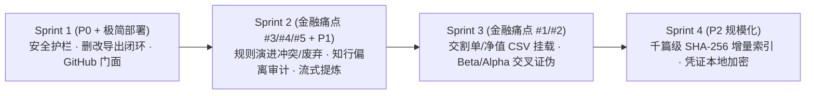

# TradeLoom 开源发版与投研专业化补齐路线图（Sprint 1 → 4）

> [!IMPORTANT]
> **核心排期原则：先堵安全漏洞与操作死胡同（能放心发 GitHub）→ 再用最低成本打出金融专业差异化（防嘴盘、抓知行偏离、判规则废弃）→ 最后接入实盘交割单/净值做定性+定量交叉验证。**

---

## Sprint 1（第一优先级 · 立即执行）：GitHub `v0.5` 首发安全护栏与闭环包

**目标**：消除本地安全隐患、补齐用户高频刚需的「删单篇 / 清示例 / 导备份」、配齐免环境启动与 CI，做完即可直接公开 `git push` 上 GitHub。

### Step 1.1：剪藏接口本地鉴权 + DNS 级 SSRF 防护（解决 P0 安全漏洞）
- **改动文件**：[provider.ts](file:///E:/DSH%20BOT/%E6%8A%95%E7%A0%94%E5%86%B3%E7%AD%96%E7%9C%8B%E6%9D%BF/tradeloom/src/lib/provider.ts)、[clip/route.ts](file:///E:/DSH%20BOT/%E6%8A%95%E7%A0%94%E5%86%B3%E7%AD%96%E7%9C%8B%E6%9D%BF/tradeloom/src/app/api/vault/clip/route.ts)、[CloudImportModal.tsx](file:///E:/DSH%20BOT/%E6%8A%95%E7%A0%94%E5%86%B3%E7%AD%96%E7%9C%8B%E6%9D%BF/tradeloom/src/components/CloudImportModal.tsx)、[cloud-ingest.ts](file:///E:/DSH%20BOT/%E6%8A%95%E7%A0%94%E5%86%B3%E7%AD%96%E7%9C%8B%E6%9D%BF/tradeloom/src/lib/cloud-ingest.ts)
- **具体做法**：
  1. 在 `workspace/config.json` 初始化时自动生成 32 位随机 `clipToken`；生成的浏览器剪藏书签脚本自动携带该 Token，`/api/vault/clip` 严格校验匹配后才允许写入，阻断任意第三方网页静默 CSRF 注入。
  2. 在 `validatePublicFetchUrl` 增加异步 `dns.lookup(hostname, { all: true })` 校验，拦截解析到 `127.0.0.0/8`、`10.0.0.0/8`、`172.16.0.0/12`、`192.168.0.0/16`、`169.254.0.0/16`、`::1` 的 DNS Rebinding 域名。

### Step 1.2：知识库「单篇移入回收站 + 一键清空示例 + 打包导出备份」（解决 P0 生命周期缺口）
- **改动文件**：[vault.ts](file:///E:/DSH%20BOT/%E6%8A%95%E7%A0%94%E5%86%B3%E7%AD%96%E7%9C%8B%E6%9D%BF/tradeloom/src/lib/vault.ts)、[doc/route.ts](file:///E:/DSH%20BOT/%E6%8A%95%E7%A0%94%E5%86%B3%E7%AD%96%E7%9C%8B%E6%9D%BF/tradeloom/src/app/api/vault/doc/route.ts)、[vault/route.ts](file:///E:/DSH%20BOT/%E6%8A%95%E7%A0%94%E5%86%B3%E7%AD%96%E7%9C%8B%E6%9D%BF/tradeloom/src/app/api/vault/route.ts)、[VaultWorkspace.tsx](file:///E:/DSH%20BOT/%E6%8A%95%E7%A0%94%E5%86%B3%E7%AD%96%E7%9C%8B%E6%9D%BF/tradeloom/src/components/VaultWorkspace.tsx)
- **具体做法**：
  1. 新增 `DELETE /api/vault/doc?card=...`：不直接物理抹除用户心血，而是安全移入 `workspace/.trash/<timestamp>_<filename>` 并自动触发 `rebuildVault()`。
  2. 新增 `POST /api/vault`（`action: "clear-samples"`）：精确识别并清理 `samples/` 导入的 6 篇演示复盘，不影响用户已导入的私有笔记。
  3. 新增 `GET /api/vault/export`：一键将整个 `workspace/vault/`（含生成的 `40-交易手册/`）流式打包导出，用户可直接拖进桌面版 Obsidian 打开或异地备份。

### Step 1.3：GitHub 开源门面与非技术用户一键启动包（解决 P0 文档 + P1 部署门槛）
- **改动文件**：[README.md](file:///E:/DSH%20BOT/%E6%8A%95%E7%A0%94%E5%86%B3%E7%AD%96%E7%9C%8B%E6%9D%BF/tradeloom/README.md)、新增 `.github/workflows/ci.yml`、`Dockerfile`、`docker-compose.yml`、`scripts/start-windows.bat`、`scripts/start-mac.command`
- **具体做法**：
  1. 重写 `README.md`：补全架构流程图、7 大云端抓取与防限流队列矩阵、Map-Reduce 跨年提炼、Skill 工坊、安全边界说明与金融免责声明。
  2. 配置 GitHub Actions：每次 Push / PR 自动跑 `pnpm typecheck` + `pnpm test` + `pnpm build`。
  3. 提供 `docker compose up -d`（自动持久化挂载 `./workspace`）及双击启动脚本，降低非程序员交易员的使用门槛。

---

## Sprint 2（第二优先级 · 高投产比金融升级）：防“嘴盘”审计 + 规则迭代冲突检测 + 流式提炼

**目标**：无需接入外部付费金融数据源，仅升级数据结构、模板与内置 Skill，直接击穿「事后合理化、嘴上纪律、前后规则打架」三大主观交易痛点，并解决长耗时提炼卡顿感。

### Step 2.1：规则生命周期状态（验证 / 迭代 / 废弃）与「知行偏离病灶榜」（金融痛点 #3 + #4）
- **改动文件**：[synthesis.ts](file:///E:/DSH%20BOT/%E6%8A%95%E7%A0%94%E5%86%B3%E7%AD%96%E7%9C%8B%E6%9D%BF/tradeloom/src/lib/synthesis.ts)、[ReportView.tsx](file:///E:/DSH%20BOT/%E6%8A%95%E7%A0%94%E5%86%B3%E7%AD%96%E7%9C%8B%E6%9D%BF/tradeloom/src/components/ReportView.tsx)
- **具体做法**：
  1. 在 `SynthesisReport.rules` 每条规则上扩展 `lifecycle: "validated" | "iterated" | "deprecated"` 与 `conflict_note?: string`：当跨月/跨季或 Map-Reduce 二次综合发现作者后期推翻了早期做法（例如从“破 5 日线无脑割”进化为“周期股看中枢逻辑不看短期洗盘”），明确标记旧规则废弃原因，不再把前后矛盾的规则混为一谈。
  2. 新增 `discipline_audit`（**知行偏离与重复违纪审计**）模块：专门要求模型从原文证据切片中找出**「作者反复立 Flag 但反复违背」**的高频病灶（如冲动追高、恐慌割肉、逆势满融），强制绑定至少 2 条不同日期的原文 `evidence_id` 证据才予以展示，帮交易员照镜子。

### Step 2.2：结构化「盘前计划 vs 盘后执行」模板 + 跨市场内置 Skill 扩充（金融痛点 #4 + #5）
- **改动文件**：[CloudImportModal.tsx](file:///E:/DSH%20BOT/%E6%8A%95%E7%A0%94%E5%86%B3%E7%AD%96%E7%9C%8B%E6%9D%BF/tradeloom/src/components/CloudImportModal.tsx)、新增 `skills/trend-swing.md`、`skills/macro-cycle.md`
- **具体做法**：
  1. 在「快捷粘贴 / 新建复盘」页签提供一键插入专业模板：**《日度盘前计划 vs 盘后执行对照表》**（含大盘环境锚定、计划标的/买点/止损位、盘中计划外操作记录、情绪打分）与 **《周度/月度归因模板》**。
  2. 新增 2 个跨市场内置只读 Skill：
     - `trend-swing.md`（**趋势波段与盈亏比管理 Skill**，兼容美港股、商品期货、Crypto 趋势交易，聚焦赔率/胜率、ATR 波动率止损、右侧加减仓）；
     - `macro-cycle.md`（**大宗周期与仓位杠杆风控 Skill**，聚焦供需拐点、库存价格弹性、净值回撤阈值与融资去杠杆纪律）。

### Step 2.3：阶段提炼 SSE 流式进度反馈与随时取消（解决 P1 大模型阻塞等待）
- **改动文件**：[provider.ts](file:///E:/DSH%20BOT/%E6%8A%95%E7%A0%94%E5%86%B3%E7%AD%96%E7%9C%8B%E6%9D%BF/tradeloom/src/lib/provider.ts)、[synthesize/route.ts](file:///E:/DSH%20BOT/%E6%8A%95%E7%A0%94%E5%86%B3%E7%AD%96%E7%9C%8B%E6%9D%BF/tradeloom/src/app/api/synthesize/route.ts)、[SynthesizeWorkspace.tsx](file:///E:/DSH%20BOT/%E6%8A%95%E7%A0%94%E5%86%B3%E7%AD%96%E7%9C%8B%E6%9D%BF/tradeloom/src/components/SynthesizeWorkspace.tsx)
- **具体做法**：支持 `stream: true` 实时推送阶段状态（`正在打包 47 篇证据切片 → 模型思考中（已生成 N 字） → 正在逐字核验 evidence_id → 正在同步回链至 Vault`），并配备前端「取消提炼」按钮（触发 `AbortController` 立即断开上游计费请求）。

---

## Sprint 3（第三优先级 · 硬核护城河 · ✅ 已完成于 v0.7.0）：实盘交割单 / 净值曲线 × 复盘笔记交叉证伪

**目标**：打通「主观文字复盘」与「客观账户盈亏」的断层，在纯本地离线前提下实现机构级投研归因（金融痛点 #1 + #2）。

### Step 3.1：本地交割单与净值 CSV 导入引擎（`workspace/ledger/`）
- **新增模块**：`src/lib/ledger.ts`、`src/app/api/ledger/route.ts`、`src/components/LedgerImportPanel.tsx`
- **具体做法**：
  1. 支持上传主流券商导出的交割单或自定义每日净值 `.csv / .tsv`（兼容 GBK / UTF-8），提供轻量字段映射器（日期、标的代码/名称、买卖方向、成交金额、总仓位%、当日盈亏/净值、可选市场基准涨跌幅）。
  2. 自动按自然日/周/月聚合客观指标：**区间收益率、最大回撤（MDD）、实盘胜率、盈亏比（Profit Factor）、最高仓位/融资暴露**。

### Step 3.2：时间轴客观锚点叠加与「盈亏证伪」提炼
- **改动文件**：[vault-builder.ts](file:///E:/DSH%20BOT/%E6%8A%95%E7%A0%94%E5%86%B3%E7%AD%96%E7%9C%8B%E6%9D%BF/tradeloom/src/lib/vault-builder.ts)、[synthesis.ts](file:///E:/DSH%20BOT/%E6%8A%95%E7%A0%94%E5%86%B3%E7%AD%96%E7%9C%8B%E6%9D%BF/tradeloom/src/lib/synthesis.ts)、[ReportView.tsx](file:///E:/DSH%20BOT/%E6%8A%95%E7%A0%94%E5%86%B3%E7%AD%96%E7%9C%8B%E6%9D%BF/tradeloom/src/components/ReportView.tsx)
- **具体做法**：
  1. 当某日的复盘卡片存在同日交割/净值记录时，自动在卡片头部与图谱时间轴挂载客观战绩徽章（如 `当日 -4.2% · 仓位 135% · 跑输基准 -3.1%`），一眼区分牛市 Beta 顺风与逆风回撤。
  2. 阶段提炼时将客观阶段绩效摘要作为只读事实注入 Prompt：如果某条“得意战法”所在阶段实际净值大幅回撤或盈亏比 `< 1`，在交易手册中自动触发 **`[实盘绩效存疑预警]`**。

---

## Sprint 4（第四优先级 · 演进打磨）：千篇级增量缓存与本地凭证加密（P2）

### Step 4.1：`sha256` 增量解析缓存与前缀树双链加速
- **改动文件**：[vault-builder.ts](file:///E:/DSH%20BOT/%E6%8A%95%E7%A0%94%E5%86%B3%E7%AD%96%E7%9C%8B%E6%9D%BF/tradeloom/src/lib/vault-builder.ts)、[pdf.ts](file:///E:/DSH%20BOT/%E6%8A%95%E7%A0%94%E5%86%B3%E7%AD%96%E7%9C%8B%E6%9D%BF/tradeloom/src/lib/pdf.ts)
- **具体做法**：将 PDF 分页文本与 Markdown 解析结果按文件 `sha256` 缓存在 `workspace/.cache/`，未改动文件零重算；将 `unlinked mentions` 升级为单遍多模式扫描，支撑 2,000+ 篇长周期档案亚秒级重建。

### Step 4.2：本地敏感凭证可选主密码加密（AES-256-GCM）
- **改动文件**：[provider.ts](file:///E:/DSH%20BOT/%E6%8A%95%E7%A0%94%E5%86%B3%E7%AD%96%E7%9C%8B%E6%9D%BF/tradeloom/src/lib/provider.ts)、[cloud-connectors.ts](file:///E:/DSH%20BOT/%E6%8A%95%E7%A0%94%E5%86%B3%E7%AD%96%E7%9C%8B%E6%9D%BF/tradeloom/src/lib/cloud-connectors.ts)
- **具体做法**：允许用户在多人共用电脑场景下设置本地解锁口令，对 `config.json` 与 `connectors.json` 中的 API Key / Token 做 AES-256-GCM 静态加密落盘。

### Step 4.3：A 股行情实时性升级与完全离线兜底（待做）
- **涉及模块**：`src/lib/market.ts`、`src/app/api/market/kline/route.ts`、`src/components/LedgerWorkspace.tsx`、`src/components/StockKlineChart.tsx`
- **具体做法**：
  1. **A 股交易时段感知缓存**：统一采用北京时间（`Asia/Shanghai`）替代 UTC 日期；盘中交易时段（`09:30~15:10`）将最新日 K 缓存 TTL 自动缩短至 **60 秒**；收盘后（`15:10` 之后）若本地缓存生成时间早于当日 `15:05`，自动触发一次精准收盘价同步，盘后与周末彻底零外网请求。
  2. **持仓实时现价与未实现浮盈快照**：接入腾讯批量实时快照接口，在 `/ledger` 持仓列表一键或自动刷新所有当前持仓股的最新价、当日涨跌幅与实时浮动盈亏。
  3. **无网 / 内网环境的离线行情 CSV 兜底**：支持导入通达信 / 同花顺导出的个股日线 `.csv` 至 `workspace/ledger/market-cache/`，满足完全断网或企业隔离内网场景下的个股 K 线与买卖点复盘需求。
